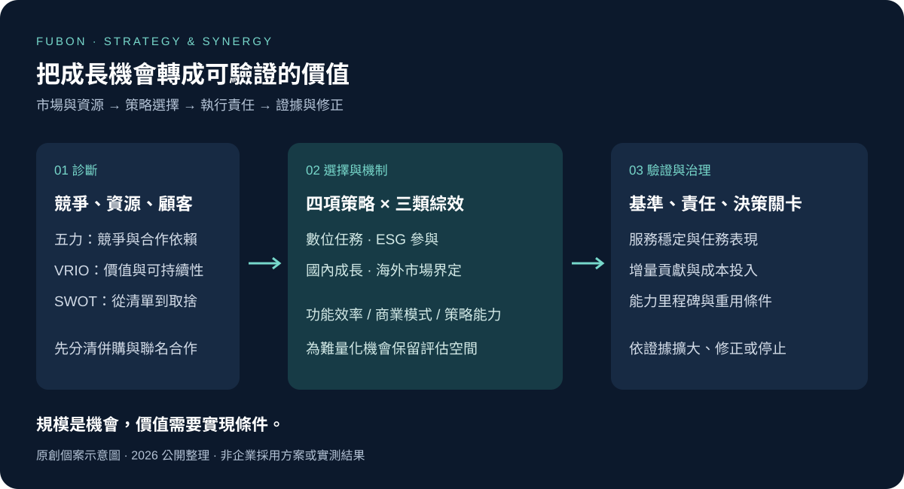
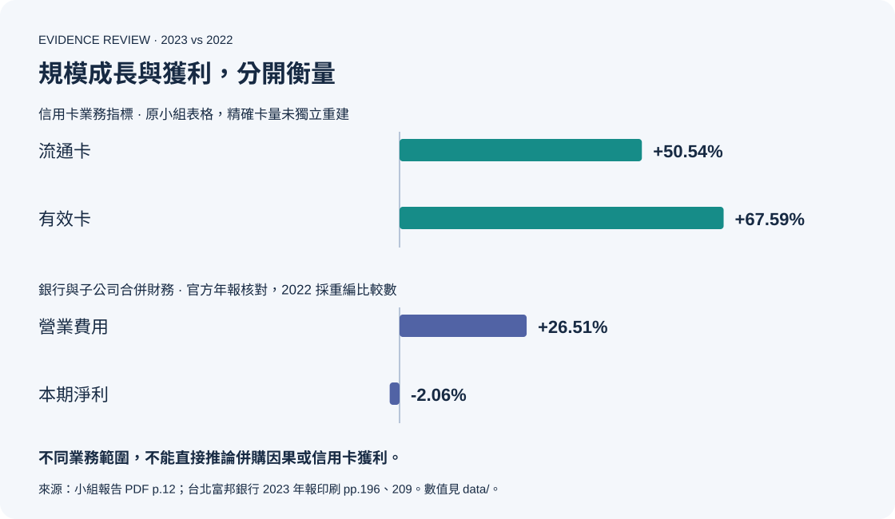

# 富邦信用卡事業：策略成長與併購綜效分析

### 從市場與資源診斷，到注意力配置與價值實現

[English](README.en.md) · [完整個案](docs/case-study.zh-TW.md) · [理論與實務](docs/theory-to-practice.md) · [執行與衡量](docs/strategy-execution.md) · [來源與頁碼](docs/sources.md)

**卡量成長、數位投資與企業合併，如何轉化為能持續創造價值的顧客關係與組織能力？**

本專案以台北富邦銀行信用卡事業為分析單位，將 2025 年國立成功大學 Business Policy and Strategy 課程的小組個案報告與本人個人論文簡報，整理為一份策略分析。以五力、VRIO、SWOT 建立診斷，再將數位服務、ESG、國內成長與海外拓展連到具體的管理決策。

> **核心判斷：** 規模擴大提供機會，價值實現則取決於整合品質、客群經營與資源配置。評估併購時，除了容易量化的成本節省，也需要為商業模式與策略能力的評估安排時間、資訊與責任人。



## 分析形成的四項策略選擇

| 策略問題 | 個案判斷與取捨 | 對應行動 |
|---|---|---|
| 數位投資如何帶來顧客價值？ | 技術能力須反映在關鍵任務的完成體驗；功能增加與顧客採用需分開衡量 | 優先改善查帳、繳款及權益理解，搭配任務成功率與留存追蹤 |
| ESG 如何連到消費者參與？ | 參與機制要有清楚的方法與可信資訊；點擊或獎勵領取不能證明減碳 | 先驗證使用價值與資料方法，再評估可追溯的環境成果 |
| 併購與聯名卡如何形成持續成長？ | 日盛併購與好市多合作是不同事件；發卡、跨售與綜效需分開歸因 | 建立三類綜效清單，追蹤成本、客群增量貢獻與能力里程碑 |
| 海外成長應從哪裡開始？ | 台灣持卡人海外消費與海外當地發卡，涉及不同市場與能力 | 先明確界定客群與市場，再決定合作、在地化與投入規模 |

以上為個案分析與本次延伸設計，並非企業已採用的方案。[完整推導](docs/case-study.zh-TW.md)

## 個人研究重點：讓併購理論改變決策

本人個人簡報解讀 Bauer 與 Friesl 的 *Synergy Evaluation in Mergers and Acquisitions: An Attention-Based View*，並連結富邦個案。該研究說明：交易時程、評估程序與參與者安排，可能使容易比較的功能性綜效獲得較多注意力，排擠較難估值的商業模式與策略綜效。

本次整理將這個觀點轉成三項管理設計：

1. **分開評估不同綜效：** 成本效率、客群與通路組合、長期能力建構，各自採合適的證據。
2. **保留跨部門評估空間：** 安排產品、營運、資訊與風險團隊共同審查假設。
3. **把綜效接到實現責任：** 每項提案寫明基準、成本、依賴條件、責任人與停止條件。

研究為作者對 19 位企業 M&A 經理與 31 位顧問的質性訪談，並非本專案自行訪談，也沒有直接證明富邦存在同樣的注意力排擠機制。[理論判讀與適用限制](docs/theory-to-practice.md) · [原研究 DOI](https://doi.org/10.1111/joms.12804)

## 數據如何改變結論



小組資料中的 2022–2023 年流通卡與有效卡分別成長約 **50.54%** 與 **67.59%**；官方年報的銀行合併口徑則顯示，營業費用增加約 **26.51%**、本期淨利減少約 **2.06%**。它們的業務範圍不同，不能相互替代，也無法單獨識別併購效果。[2023 年官方年報，印刷頁 196、209](https://www.fubon.com/banking/document/about/intro_FBB/TW/TaipeiFubonBank112.pdf)

這支持的判斷是：**應分開衡量獲客、活躍使用、成本效率與獲利。** 官方合併時點亦已核對：金控層級為 2022 年 11 月 11 日，銀行層級為 2023 年 4 月 1 日，公開版本據此修正原稿的 2025 年時點。[富邦合併公告](https://www.fubon.com/financialholdings/news/news_1230411_209213.htm)

[數據定義](data/README.md) · [原稿與公開版本的差異](docs/evidence-review.md)

## 專業能力與可檢查的成果

| 能力 | 本專案中的具體呈現 |
|---|---|
| 商業與策略診斷 | [競爭壓力、資源條件與策略優先順序](docs/case-study.zh-TW.md) |
| 理論判讀與轉譯 | [注意力基礎觀點、三類綜效及理論適用範圍](docs/theory-to-practice.md) |
| 數據解讀與批判分析 | [指標重算、事件分離、財務科目修正與因果限制](docs/evidence-review.md) |
| 策略執行與治理 | [分階段決策、責任角色、衡量定義與停止條件](docs/strategy-execution.md) |
| 結構化溝通 | 中英文導讀、原創分析圖、[綜效工作表](templates/synergy-register.csv)與[指標字典](templates/metric-dictionary.csv) |

## 成果歸屬與分析範圍

李奕成（Eason）共同參與 Very First Group 整份小組報告；另有本人署名的 19 頁個人論文簡報。小組報告為共同成果，學術理論及訪談研究歸原作者所有。本次公開整理新增證據修正、決策優先順序、執行方案與衡量工具。[貢獻說明](docs/contribution.md)

這是以 2025 年課程材料為基礎的**歷史個案分析**，於 2026 年重新整理並核對部分官方來源。未取得企業內部訪談、顧客逐筆資料、整合成本明細或綜效追蹤紀錄；沒有宣稱建議已落地或達成效益。四份原始 PDF 保留於本機，公開內容採重寫分析、彙總數值與來源索引。[使用與歸屬](NOTICE.md)

## 數值核對

使用 Python 3 標準函式庫可重新計算公開資料的成長率與有效卡占比：

```bash
python3 scripts/review_metrics.py
```

此工具核對轉錄資料的計算一致性，不會估計實際綜效或重現原作者訪談研究。
